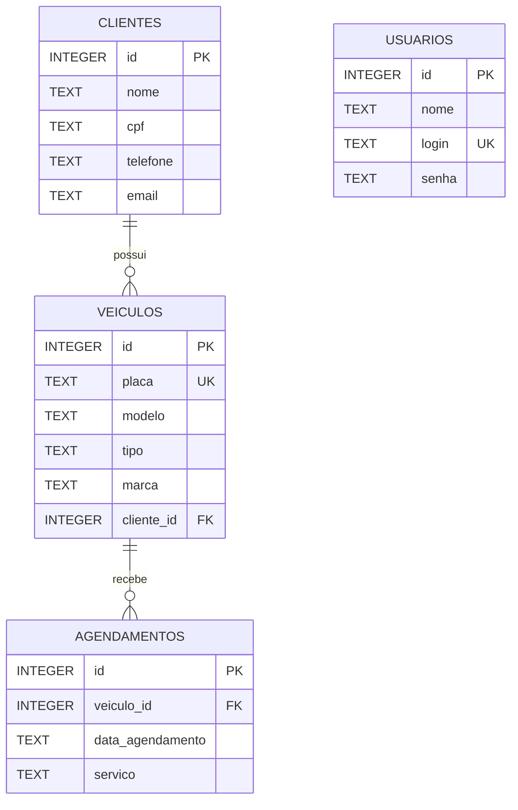

# 2. DER — Diagrama entidade-relacionamento

O modelo contém quatro tabelas: `usuarios`, `clientes`, `veiculos` e `agendamentos`.

## Dicionário de dados

### `usuarios`
- `id`: chave primária autoincremental.
- `nome`: nome exibido na sessão.
- `login`: identificador de login único.
- `senha`: hash bcrypt, não senha em texto puro.

### `clientes`
- `id`: chave primária.
- `nome`: obrigatório.
- `cpf`: texto criptografado com AES-256-GCM na aplicação.
- `telefone`, `email`: dados de contato opcionais.

### `veiculos`
- `id`: chave primária.
- `placa`: obrigatória e única.
- `modelo`, `tipo`: obrigatórios.
- `marca`: opcional.
- `cliente_id`: chave estrangeira para `clientes.id`.

### `agendamentos`
- `id`: chave primária.
- `veiculo_id`: chave estrangeira para `veiculos.id`.
- `data_agendamento`: texto no formato `AAAA-MM-DD`.
- `servico`: descrição do serviço.

## Cardinalidades
- Um cliente pode estar associado a vários veículos; cada veículo está associado a um cliente.
- Um veículo pode ter vários agendamentos; cada agendamento está associado a um veículo.
- A tabela `usuarios` não possui relacionamento direto com as demais tabelas no esquema atual.

## Observação
As cardinalidades de “um para muitos” decorrem das chaves estrangeiras; o banco não obriga que todo cliente ou veículo tenha registros dependentes.
