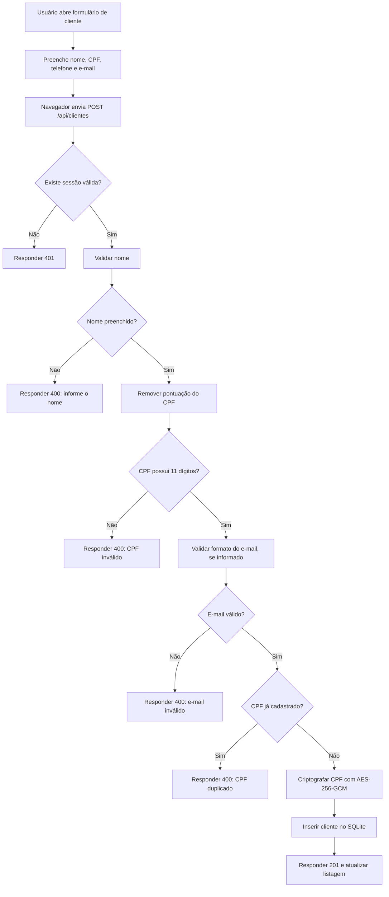

# 7. Diagrama de fluxo — cadastro de cliente

O diagrama representa a sequência implementada em `server.js`. A validação de CPF existente verifica comprimento e duplicidade, mas não os dígitos verificadores.
